# Pixel Hearth

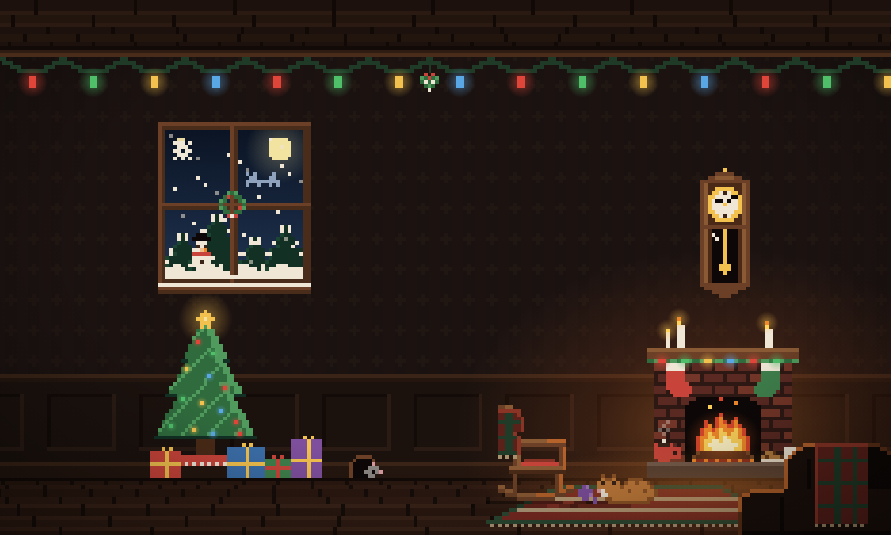

A cozy dark theme for the Claude desktop and mobile apps. The backdrop is a
pixel-art living room with a fire, a rocking chair and a sleeping cat. The
colors are warm browns with candlelight text.

The room changes with the season. From March 20 to June 20 it is spring:
tulips and a bird's nest on the mantel, ivy trailing from it, an umbrella, rain
boots and a potted plant in the corner, bunting overhead, and trees in blossom
outside. From June 21 to September 21 it is summer: a model sailboat and a jar
of shells on the mantel, a straw hat hung below it, a fishing rod, a beach ball
and a picnic basket, paper lanterns overhead, and sunflowers outside, with
fireflies at night.

October is Halloween: jack-o'-lanterns and a bowl of candy corn on the mantel,
a cobweb and a spider below it, a pail of candy by the fire, a broom and a
jack-o'-lantern in a witch's hat in the corner, paper bats and orange lights
overhead, and bare trees over a pumpkin patch outside, with bats across the
moon at night.

The rest of autumn, September 22 to 30 and November 1 through Thanksgiving,
has pumpkins on the mantel, corn stalks and a hay bale, a pie by the hearth,
and autumn trees through the window. The day after Thanksgiving it turns to Christmas, with
stockings, a tree with presents, lights, and snow outside. Presents are open
from Christmas Day, and a banner is up for New Year. From January 2 to March 19
it is winter: mittens dry on the mantel, a coat rack, ice skates and snow boots
stand where the tree was, paper snowflakes hang from the ceiling, and the snow
stays outside.

Some days get a room of their own. On Valentine's Day the winter room has
hearts hung from the mantel, roses and chocolates on it, and paper hearts on
the window. On St. Patrick's Day it turns green and gold, with shamrocks, a
green hat, a pot of gold by the fire and a rainbow over the snow by day. On
Easter the spring room has a chocolate bunny on the mantel, a basket of painted
eggs by the fire, painted eggs strung overhead and eggs hidden in the grass
outside. On the Fourth of July the summer room is dressed in red, white and
blue, with bunting below the mantel, a flag on it, a flag in the yard by day
and fireworks at night. On Thanksgiving Day the autumn room has a horn of plenty
on the mantel, a roast turkey on the hearth and a Give Thanks banner.

The sky follows the time of day. The room is drawn when a session starts, so it
picks up the date and time then.

The terminal and editors don't draw themes, so the mod changes nothing there.

## The rooms

These are the backdrop on its own. In the app, the conversation sits over it
behind a light veil.

<table>
<tr><td width="50%">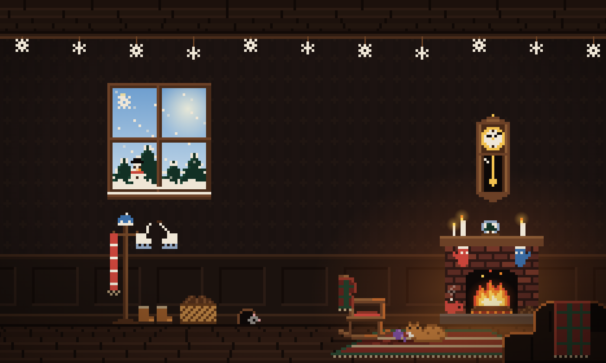<br>Winter, January 2 to March 19</td><td width="50%">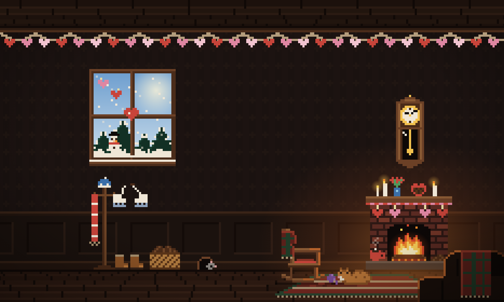<br>Valentine's Day</td></tr>
<tr><td width="50%">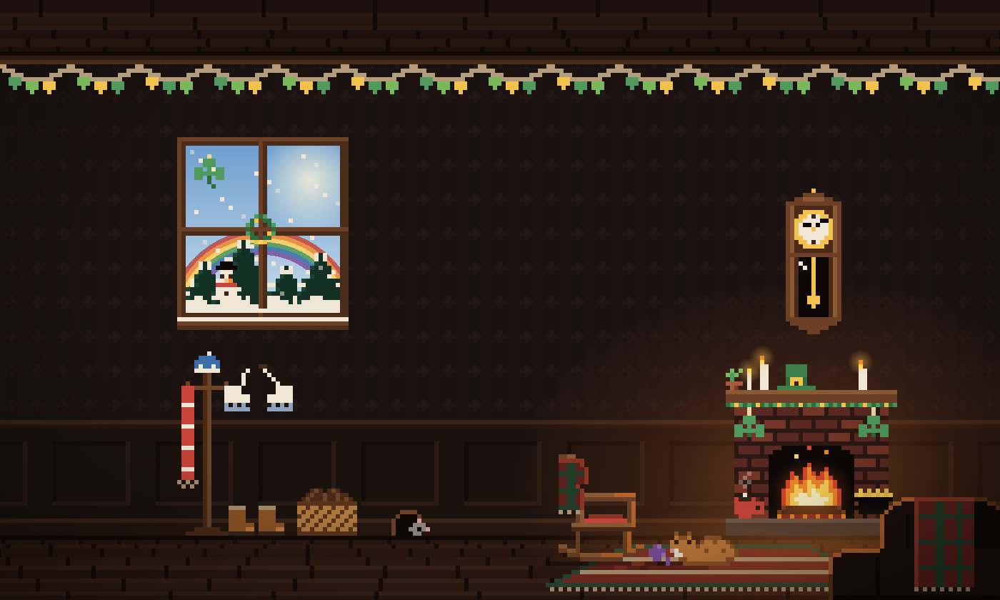<br>St. Patrick's Day</td><td width="50%">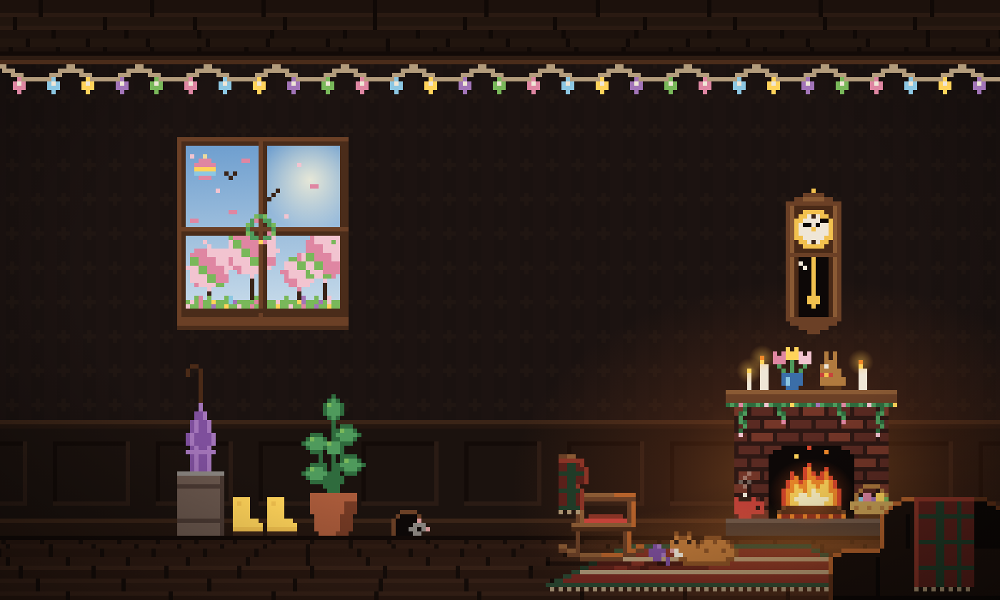<br>Easter</td></tr>
<tr><td width="50%">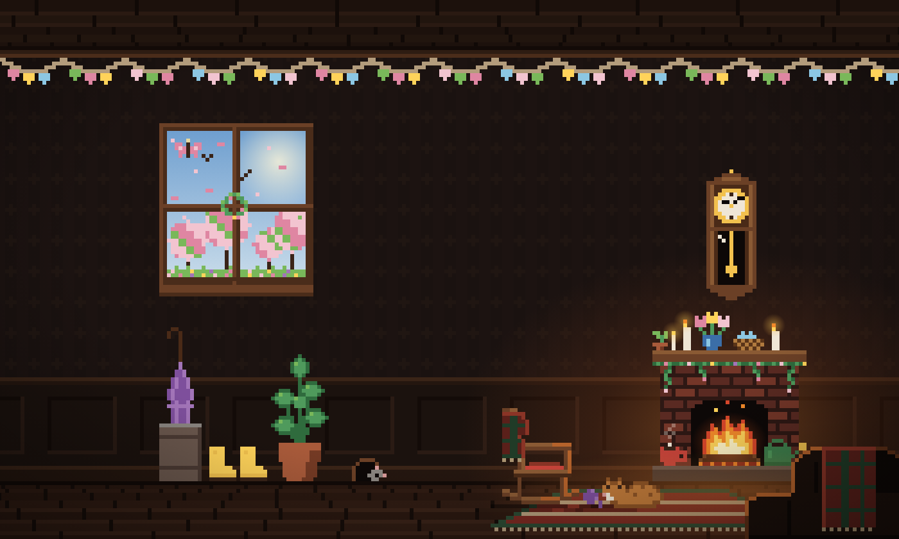<br>Spring, March 20 to June 20</td><td width="50%">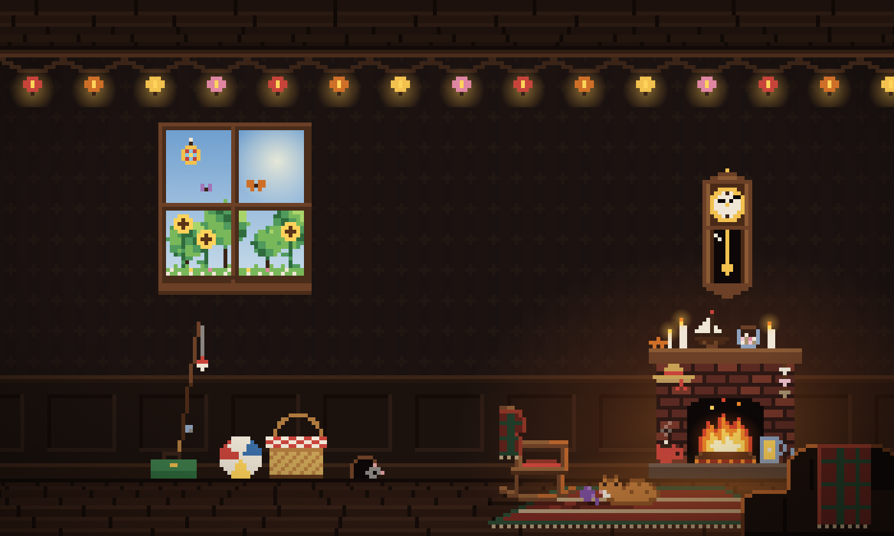<br>Summer, June 21 to September 21</td></tr>
<tr><td width="50%">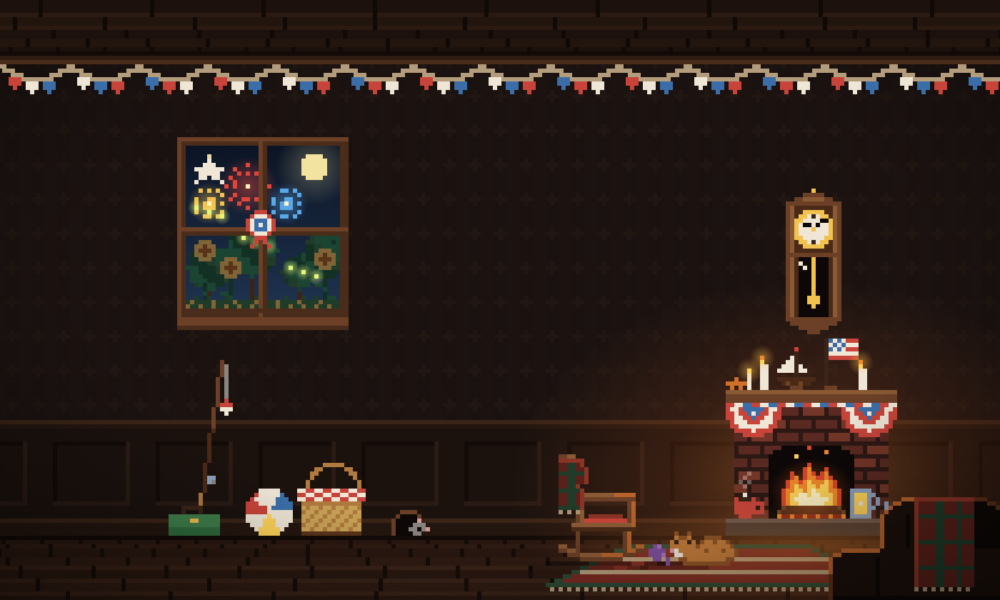<br>The Fourth of July, at night</td><td width="50%">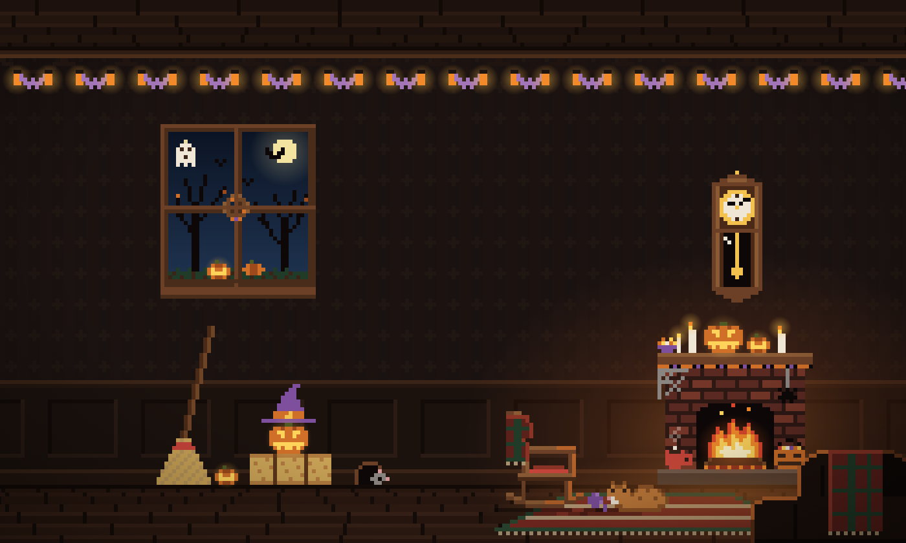<br>Halloween, all of October, at night</td></tr>
<tr><td width="50%">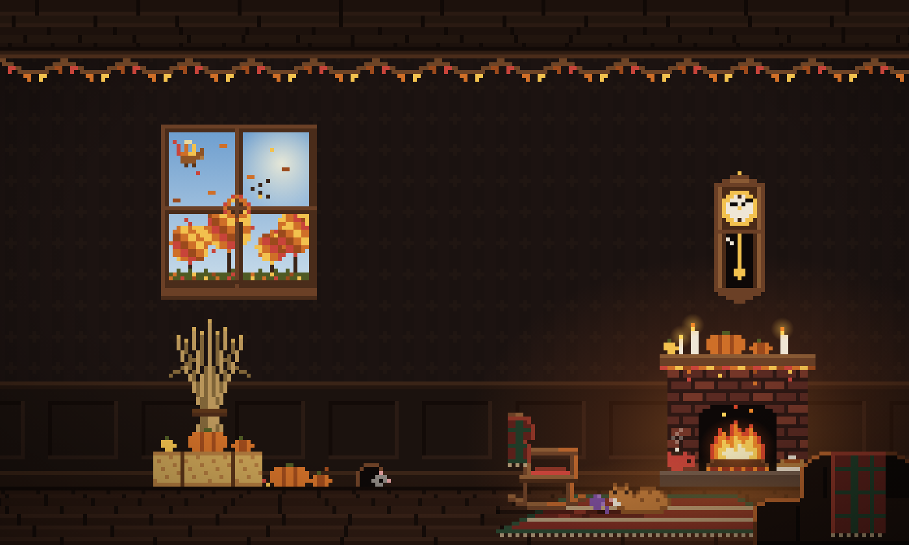<br>Autumn, late September and November</td><td width="50%">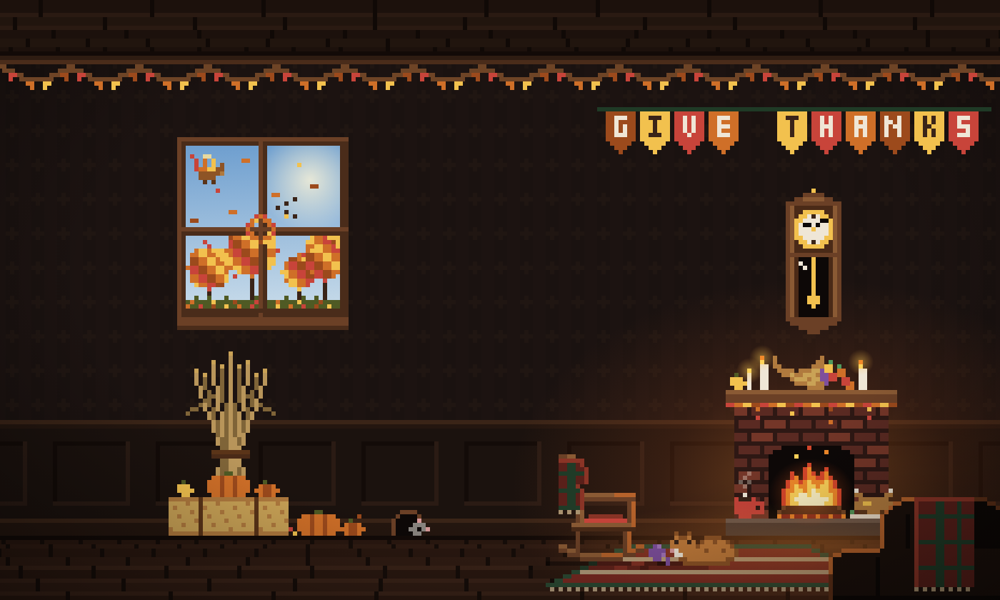<br>Thanksgiving Day</td></tr>
<tr><td width="50%"><br>Christmas, at night</td><td width="50%">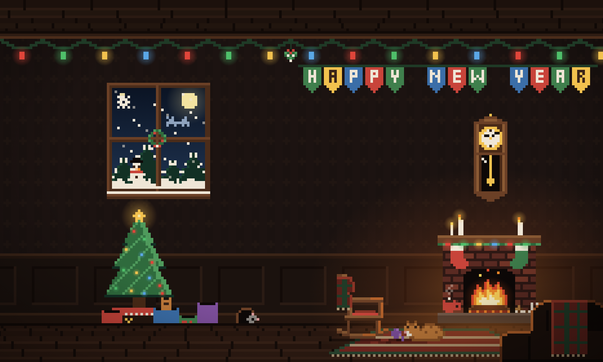<br>New Year's Eve and Day, at night</td></tr>
</table>

## Install

At the prompt of a Claude Code session:

```
/plugin install pixel-hearth --marketplace spencerbart/pixel-hearth
```

Answer `y` to add the marketplace, then pick a scope.

From a shell:

```bash
claude plugin install pixel-hearth --marketplace spencerbart/pixel-hearth
```
